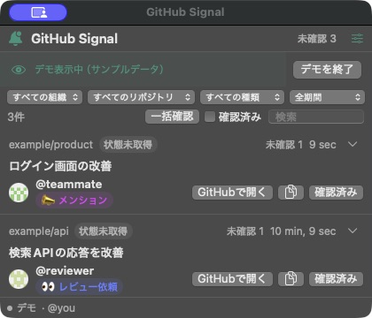

# GitHub Signal

レビュー依頼をPRごとに整理して、あとで戻れる。

GitHub Signalは、GitHub CLIを使う開発者向けのMac・Windows常駐アプリです。個人宛てのレビュー依頼やメンション、自分のPRへのコメント・レビューをまとめて確認できます。

**紹介サイト**: <https://signal-boost-guide.lovable.app>（機能と画面を1ページにまとめました）



画像はサンプルデータ。実際のリポジトリ名・PR・投稿者は含まない。

## 導入手順

### 1. 配布ファイルをダウンロードする

[Releasesの最新版](https://github.com/zimathon/github-notification/releases/latest)から、自分のOSに合ったZIPをダウンロードする。

| OS | 配布ファイル | 対応環境 |
| --- | --- | --- |
| Mac | `*-macos-arm64.zip` | Apple Silicon・macOS 13以降 |
| Windows | `*-windows-x64.zip` | Windows 11 x64（.NET同梱） |

- **Mac**: ZIPを展開し、`GitHub Signal.app`をアプリケーションフォルダへ移して起動する。
- **Windows**: ZIP全体を展開し、`GitHubSignal.exe`を起動する。.NETランタイムを同梱しているため、.NETの事前インストールは不要。

どちらの配布版もコード署名を行っていない（Macはアドホック署名で、Developer IDによる署名・公証は行っていない）。初回の起動時にOSから警告が出ることがある。

### 2. GitHub CLIにログインする

アプリはGitHub CLI（`gh`）経由でGitHubへ接続する。トークンをコピーしたり管理したりする必要はない。

```sh
# Mac
brew install gh

# Windows（PowerShell）
winget install --id GitHub.cli -e

# 共通
gh auth login --hostname github.com --web
```

通知の取得には`notifications`または`repo`の権限が必要で、非公開PRの詳細取得には`repo`が必要になる。権限が足りないときは、必要な権限だけを追加する。

```sh
gh auth refresh --hostname github.com --scopes notifications
```

組織によってはSSOの認可が別途必要になる。アプリ自体が権限を変更することはない。

### 3. 通知を開始する

1. アプリの「通知を開始」（Windowsは「開始」）を押す。
2. OSから通知許可を求められたら許可する。
3. 設定画面の「テスト通知」で、バナーが届くことを確認する。

初回は直近24時間に更新された通知が対象になる。以後は取得位置を保存するので、アプリを再起動しても続きから確認できる。

### 4. 必要に応じて設定する

- **通知対象を絞る**: 設定の「通知対象の組織・ユーザー」に`org-a, org-b`のように入力して「適用」を押す。空欄にするとすべてが対象。個人所有のリポジトリは、その人のGitHubユーザー名で指定する。
- **ログイン時に自動起動**: 設定の「ログイン時に起動」をオンにすると、次回ログイン時からメニューバー／タスクトレイに常駐する。初期値はオフ。
- **取得・再通知の間隔やBot通知**: 設定から変更できる。

## 使う

- **同じPRをまとめて表示**。メニューバー／タスクトレイで未確認件数を確認できる。
- **✅ 承認・👀 レビュー依頼などを区別**。PRのOpen・Draft・マージ済み・クローズも表示する。
- **タイトルからGitHubへ移動**。開いても未確認のまま残る。確認済みの操作は⌘Z（WindowsはCtrl+Z）で取り消せる。
- **スターで後から見返す**。PR・Issueを保存し、確認済みでもスター付き一覧に残せる。
- **組織・リポジトリ・種類・日付で絞り込み**。「一括確認」で表示中のPRをまとめて確認済みにできる。
- **通知対象は設定で変更**。一覧の表示フィルタとは別に、通知する組織を指定できる。

ウィンドウを閉じても監視は続く。アプリ終了中やPCのスリープ中は止まる。新しいバージョンは通知で案内し、更新は手動で行う。

## データの保存と削除

- 保存先: Macは`~/Library/Application Support/GitHubSignal/inbox.json`、Windowsは`%LOCALAPPDATA%\GitHubSignal\inbox.json`。
- 認証トークンは保存しない。
- 削除するときは、先に「ログイン時に起動」をオフにする。Windows版を別のフォルダへ移した場合は、移動先のアプリで設定を保存し直す。

## 詳細

詳しい設定・権限・トラブル対応・ビルド方法は[詳細ガイド](docs/usage.md)を参照。

紹介サイト: <https://signal-boost-guide.lovable.app>
